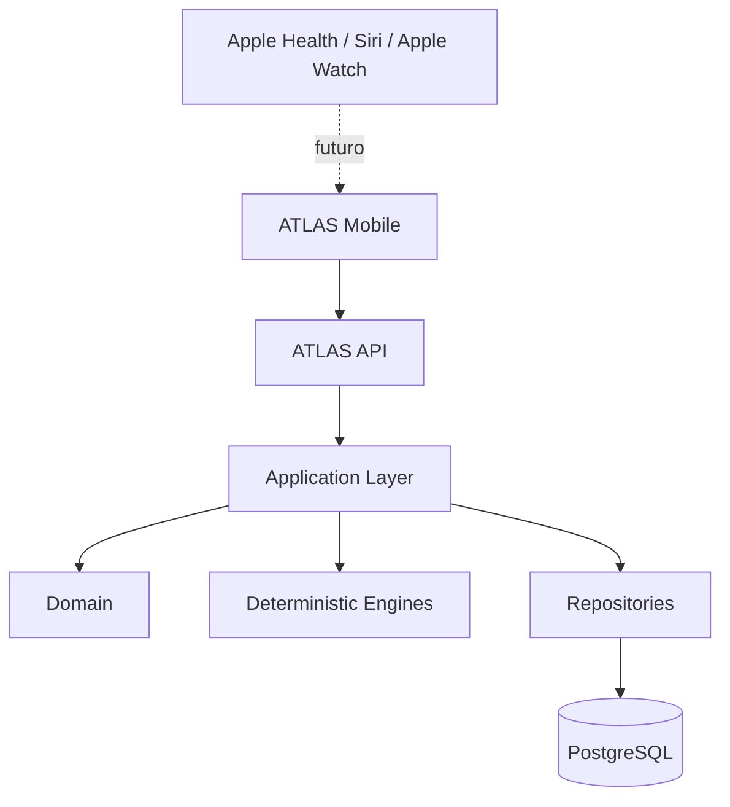

# ATLAS Executive Report

## Executive Summary

ATLAS (Adaptive Training & Load Analysis System) es una plataforma de seguimiento y asistencia para fuerza, powerlifting e hipertrofia. Comienza como herramienta para un atleta, pero su arquitectura no está hardcodeada a una persona y puede crecer hacia un producto multiusuario.

## Product Vision

ATLAS conectará la planificación del coach con la ejecución real y, progresivamente, con carga, reps, RIR/RPE, variantes, historial, sueño, nutrición, cafeína, actividad, estrés, fatiga y equipamiento. **ATLAS no reemplaza la autorregulación del atleta; la cuantifica.**

## Problem

La intención del plan y la ejecución suelen vivir en notas, hojas de cálculo o memoria. ATLAS conserva ambas capas para comparar lo prescrito con lo realizado sin sobrescribir el dato original ni interpretar antes de tiempo.

## Product Principles

- Registrar primero. Interpretar después.
- Personalización mediante configuración y datos, no hardcode.
- Deterministic engines first, AI explanation later.
- Recommendations must be explainable.
- Confidence reflects evidence quality.
- Correlation does not imply causation.
- Mucha capacidad con poca fricción: automatic data > quick input > advanced optional input.

## High-Level Architecture



La API es un modular monolith. Domain y engine-core son puros y no dependen de React Native, Fastify, Drizzle o PostgreSQL; la infraestructura depende hacia adentro.

## Training Model

El plan prescrito actual es:

```text
Athlete
└── Mesocycle
    └── TrainingWeek
        └── WorkoutDay
            └── ExercisePrescription
                └── PrescriptionSet
```

Se relaciona con `Movement → Exercise → ExerciseVariant`, cuyos modifiers permiten flexibilidad estructurada. F1-001 implementó únicamente PLANNED. ACTUAL será `WorkoutSession → SessionExercise / ExercisePerformance → SetLog` en F1-002 y todavía no está implementado.

## Data Strategy

Los futuros contextos MORNING, PRE_WORKOUT y END_OF_DAY se registrarán como observaciones. Históricos incompletos podrán conservar fuente, nivel de confianza, secuencia y fecha aproximada. La interpretación vendrá después.

## Recommendation Strategy

Los futuros engines producirán valor, confidence, razones y evidencia. La calidad de evidencia seguirá la jerarquía variante exacta → variante relacionada → ejercicio base → familia de movimiento.

## Personalization Strategy

Equipamiento, preferencias, perfiles de gimnasio y presets serán datos configurables. El atleta inicial es una configuración de despliegue, no una identidad codificada en el dominio.

## Apple Ecosystem Strategy

HealthKit, Apple Health, Apple Watch, App Intents y Siri son integraciones futuras desacopladas. No son capacidades actuales.

## Current Capabilities

El código actual ofrece monorepo pnpm TypeScript, app Expo Router mínima, API Fastify, PostgreSQL/Drizzle, modelo prescrito persistente, catálogo de movements/exercises/variants, Zod runtime validation, seed, plan API, tests y quality scripts. La API incluye health, CRUD mínimo de catálogo y creación/consulta de atletas y planes.

No están implementados sesiones reales, SetLog, dashboards, engines de recomendación, nutrition UI, Apple Health, auth, Siri, Watch ni AI.

## Current Status

F0 está completa. F1 está en progreso: el modelo prescrito está disponible y la capa ACTUAL permanece pendiente. Consulta el [ROADMAP](ROADMAP.md) para estados y delivery.

## Roadmap Summary

F0 Foundation → F1 Training Tracker → F2 Load Adjustment → F3 Athlete Context → F4 Nutrition & Caffeine → F5 Apple Health → F6 Historical Import → F7 Analytics → F8 Progression → F9 Pivot → F10 Readiness & Fatigue → F11 Powerlifting → F12 Siri & Apple Watch → F13 ATLAS Intelligence.

## Risks / Open Questions

- Momento adecuado para auth y aislamiento multiusuario.
- Utilidad y permisos de datos de Apple Health.
- Calibración de confidence con historiales incompletos.
- Evitar presentar asociaciones como causalidad.
- Mantener baja la fricción de captura.

## Next Milestone

La dirección de delivery es F1-001A como hardening del modelo prescrito y posteriormente F1-002 para el modelo ACTUAL. Ninguno de esos trabajos se implementa en este documento.
