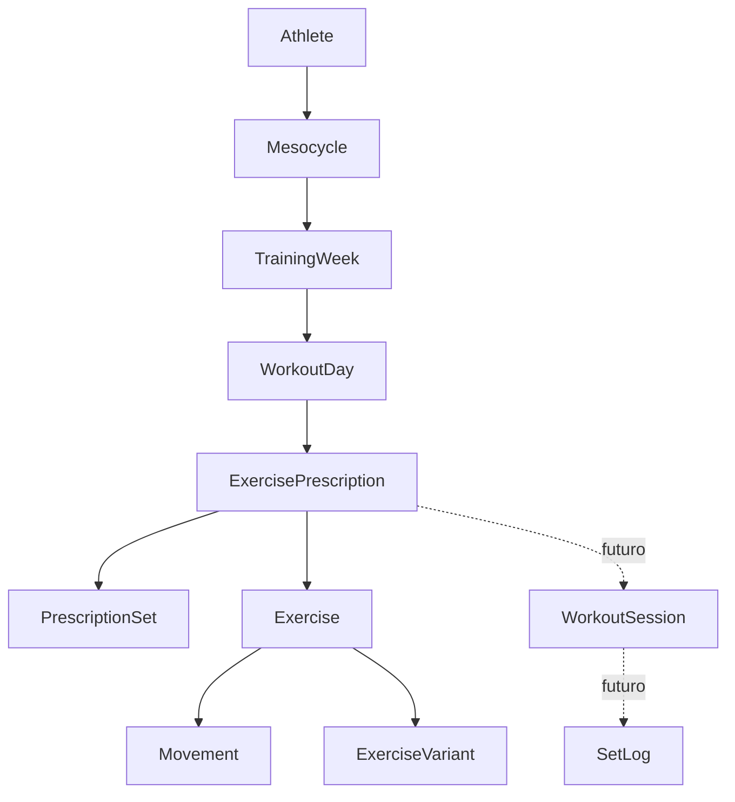

# Training model: planned vs actual

F1 implementa únicamente el plan prescrito. Un plan empieza en un `Athlete`, contiene `Mesocycle`, `TrainingWeek`, `WorkoutDay` y `ExercisePrescription`; cada prescription contiene `PrescriptionSet` estructurados.

`ExerciseVariant.modifiers` es JSON estructurado para conservar flexibilidad (`tempo`, pausas, postura, etc.). No se modelan sesiones realizadas ni logs en F1. Más adelante `WorkoutSession → ExercisePerformance → SetLog` se comparará con el plan para alimentar engines, sin mezclar prescripción con desempeño.
